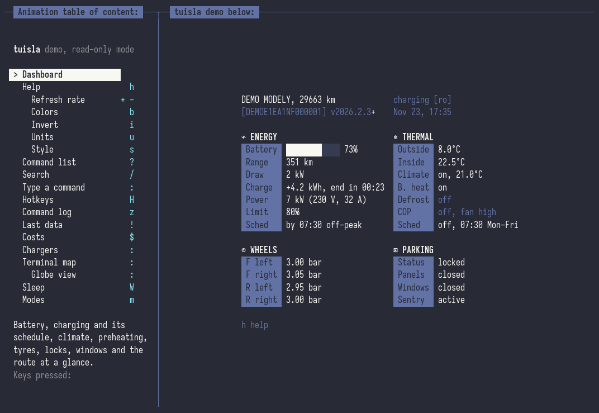

# tuisla

A TUI to check on and control your Tesla from the comfort of your terminal:
battery, charging, climate, tyres, locks and the current route at a glance,
commands like lock, climate or charge limit from the keyboard, and nearby
chargers on a map in the terminal, one key away from being the destination.

It runs on Linux, macOS or even Android (Termux).



*The left pane is just a table of contents; the actual app is on the
right only (demo data, read-only mode).*

## What you need

- Python 3 and `curl`.
- On Linux, `xdg-mime` (package `xdg-utils` on Guix and most distros) so `--login` can catch the Tesla sign-in link by itself. Without it, you have to copy that link from the browser by hand.
- A Tesla account. Reading your car's information is free.
- A [MyTeslaMate API](https://www.myteslamate.com/api/)
  token is needed to send commands to the car. This is a pay-as-you-go thingie, about 1€ for 500 commands per month. You *do not* need a "MyTeslaMate instance" subscription, just the API.

## Setup

`tuisla` is just a standalone Python script, so you just need to have Python 3 and make the script executable with `chmod a+x tuisla`.

```sh
# First execution:
./tuisla --login  # will help you get and store your Tesla and MyTeslaMate API tokens

# From there, just:
./tuisla
```

You can skip the MyTeslaMate step if you don't want to send commands to the car. Without any login, `./tuisla` will just show demo data.

## Use

`h` help · `?` all commands · `:` type a command · `w` wake the car · `W` keep it awake · `q` quit

## Modes

- `--mode mtm` (default, recommended), commands are sent to the car through the MyTeslaMate API.
- `--mode ro` (read-only), commands are checked for validity, but not sent.
- `--mode vc`, commands are signed by tuisla itself with your own key, through Tesla's [vehicle-command](https://github.com/teslamotors/vehicle-command) proxy, and sent with your own Tesla developer app instead of MyTeslaMate. Run `./tuisla --setup-vc` once (it runs `tuisla-setup-vc`, which must sit next to `tuisla`): it walks you through every step (keys, publishing the public key on a free GitHub Pages site, the Tesla developer app, adding the key to the car from the Tesla app) and checks each one. It needs `openssl`, plus [Go](https://go.dev/) and git to build the proxy: on Guix or Nix it runs them in a temporary `guix shell` / `nix-shell`, elsewhere it offers to install them with your package manager (apt, dnf, pacman, zypper, apk, Homebrew or Termux) and to remove them again at the end, or you can install them yourself. You also need a payment card on the Tesla developer site; Tesla's $10 monthly credit covers a personal car. When there is no internet route to the car (an underground car park, airplane mode), vc mode sends lock, unlock, allow driving, trunk, frunk, climate, charging and a few other commands over Bluetooth instead, with Tesla's `tesla-control`, which the setup builds too (on Linux it asks once for `sudo setcap cap_net_admin=eip` so it can use Bluetooth). Once set up, vc mode also works without `--login-tesla`, but vehicle data then comes from the billed Fleet API, so tuisla refreshes every 60 s at most.

See `./tuisla --help` for more options.

[FILES.org](FILES.org) lists the files tuisla keeps (tokens, keys, caches) and which ones are needed.

## Commands

Press `?` for the full list. Besides the usual lock, climate and charging commands, there are seat heating and cooling (`seat heat driver 2`), climate keeper and dog mode (`keeper dog`), cabin overheat protection, Guest Mode, PIN to Drive, speed limit, renaming the car, sending a destination (`navigate 1 Main St, Springfield` or `navigate gps 37.49 -121.94`), Homelink, waking the car, and:

- `map` / `mapscii`: the car's location on OpenStreetMap in the browser, or in the terminal with [mapscii](https://github.com/rastapasta/mapscii) (its version with start coordinates is still [a pull request](https://github.com/rastapasta/mapscii/pull/161), which tuisla fetches and builds on first use with git and Node.js; on Guix: `guix install node git`). `map chargers` and `mapscii chargers` add the nearby chargers (◯ the car, ■ Superchargers, ▮ destination chargers, all fitted on screen), and `mapscii globe` shows them on the whole Earth: press `o` there for a 3D globe. Quitting the map leaves nothing behind in the terminal.
- `chargers`: nearby Superchargers with free stalls and destination chargers; pick one with `j`/`k` and press Enter to send it to the car as the destination.
- `route`: the destination, distance, arrival time and battery left at arrival. While a route is active the dashboard shows it too.

The car cannot be put to sleep through the API, but it falls asleep on its own when nothing asks it for data for about 15 minutes. tuisla lets it by default: it only polls whether the car is awake, fetches data only while the car is driving, charging or conditioning (or when you press `r`), and wakes it only to deliver a command, after which it falls asleep again. `w` wakes it once and lets it fall asleep again; `W` (or starting with `-W`) keeps it awake. While the car is asleep or out of reach (an underground car park, say), the dashboard shows the last data tuisla saw, with its time at the top right.

Not possible: Sentry Mode and dashcam clips are only stored on the car's USB drive, and the live Sentry camera view only works in Tesla's own app; no API gives access to them.

## Credits

`mapscii` runs [MapSCII](https://mapscii.me) ([rastapasta/mapscii](https://github.com/rastapasta/mapscii)) by Michael Straßburger, in the version from [pull request 161](https://github.com/rastapasta/mapscii/pull/161) by [Fefedu973](https://github.com/Fefedu973), which adds start coordinates, markers and the 3D globe. Map data © [OpenStreetMap](https://www.openstreetmap.org/copyright) contributors.
