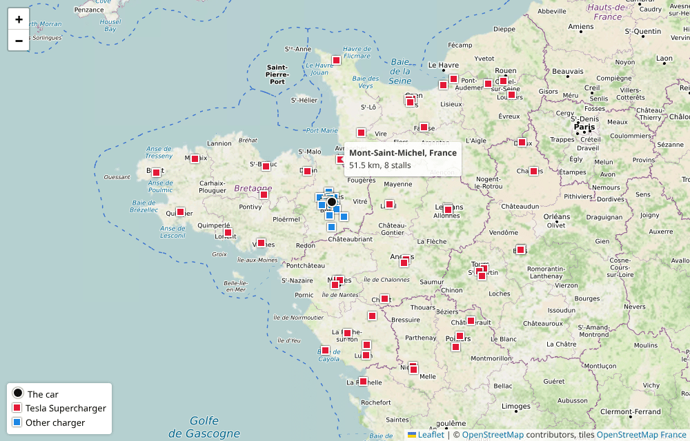
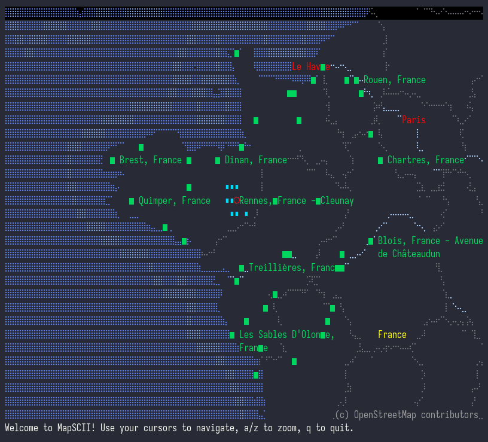

# `tuisla`

A TUI to check on and control your Tesla from the comfort of your terminal:
battery, charging, climate, and locks at a glance, commands like trunk, lock,
climate or charge limit from the keyboard, and the car or nearby chargers on
a map.

It runs on Linux, macOS or even Android (Termux).


*The left pane is just a table of contents for this demo; the actual app is
on the right only (demo data, read-only mode).*

## What you need

- Python 3 and `curl`.
- On Linux, `xdg-utils`, so that `--login` can catch the Tesla sign-in link by itself and `map` opens your browser. Without it, you have to copy the sign-in link from the browser by hand, and open maps yourself.
- Optionally, a font with the icons of the fancy style (⌁ ❄ ◎ ⊡ ⌖), such as Iosevka; DejaVu Sans Mono lacks ⌖, which most terminals then take from another font.
- A Tesla account. Reading the car's information works out of the box and needs no extra API, except the current route (destination, arrival time and energy), which needs vc mode: MyTeslaMate's copy of the car's data holds no valid route or position.
- To send commands to the car, one of:
  - a [MyTeslaMate API](https://www.myteslamate.com/api/) token: a pay-as-you-go thingie, about 1 € for 500 commands per month. You *do not* need a "MyTeslaMate instance" subscription, just the API.
  - vc mode (see [Modes](#modes)): no paid API, but more involved to set up.

## Setup

`tuisla` is a standalone Python script for the most part (it only calls an accessory script, `tuisla-setup-vc`, once if you set up vc mode), so you just need Python 3 and to make the script executable with `chmod a+x tuisla`.

```sh
# First execution:
./tuisla --login  # gets and stores your Tesla token, then your MyTeslaMate API token or sets up vc mode

# From there, just:
./tuisla
```

You can skip the MyTeslaMate step if you don't want to send commands to the car, or if you favour vc mode. Without any login, `./tuisla` will just show demo data.

## Use

`h` help · `?` all commands · `:` type a command · `w` wake the car · `W` keep it awake · `q` quit

## Modes

- `--mode mtm` (default, recommended): commands are sent to the car through the MyTeslaMate API.
- `--mode ro` (read-only): commands are checked for validity, but not sent.
- `--mode vc` (vehicle-command): commands are sent through Tesla's own [vehicle-command](https://github.com/teslamotors/vehicle-command) proxy instead of MyTeslaMate, with your own Tesla developer account and a key paired with your car. This mode requires no paid API (a monthly credit from Tesla, $10 in the US or €10 in Europe, covers a personal car, commands costing $1 per 1,000, though its developer site asks for a payment card), but its setup is more involved: `./tuisla --setup-vc` (or `--login`) walks you through it. It needs `openssl` and Go; on Guix and Nix, it runs them in a temporary `guix shell` / `nix-shell` instead of installing them, and elsewhere it offers to install them and remove them again at the end. It can work over Bluetooth when the phone or the car has no network (*e.g.*, an underground car park), once the key is also added over Bluetooth, which the setup's last, optional step does next to the car. `tuisla` uses vc mode by default when it is set up and MyTeslaMate is not.

See `./tuisla --help` for more options, and [FILES.org](FILES.org) for the files `tuisla` keeps.

## Commands

`:` types a command (Tab completes it), `?` shows this list in the app. Tesla's commands:

```
Security
  sentry on|off                Enable/disable Sentry Mode
  valet on|off                 Enable/disable valet mode (valet on <pwd>)
  valet reset pin              Clear the valet mode PIN
  guest on|off                 Enable/disable Guest Mode
  pin2drive on|off <pin>       Enable/disable PIN to Drive
  pin2drive reset              Clear the PIN to Drive PIN
  honk                         Honk the horn
  flash                        Flash the lights
  remote start                 Allow keyless driving for 2 minutes

Locking
  lock|unlock                  Lock/unlock the doors
  windows vent|close           Vent/close all windows
  trunk|frunk open             Open the rear trunk/the frunk
  tonneau open|close|stop      Open/close/stop the tonneau (Cybertruck)

Charging
  charge start|stop            Start/stop charging
  charge limit <percent>       Set charge limit % (e.g. charge limit 80)
  charge max|std               Charge limit to max range/standard
  charge amps <charging_amps>  Set charging amps (e.g. charge amps 16)
  port open|close              Open/close the charge port

Climate
  climate on|off               Turn climate on/off
  temp <temp>                  Set both seats temp (e.g. temp 21)
  temp_driver <temp>           Set driver temp only (e.g. temp_driver 21)
  temp_passenger <temp>        Set passenger temp only (e.g. temp_passenger 19)
  defrost on|off               Enable/disable max defrost/preconditioning
  seat heat <seat> <level>     Seat heat level 0-3 (e.g. seat heat driver 2)
  seat cool <seat> <level>     Front seat cooling level 0-3 (e.g. seat cool passenger 1)
  seat auto on|off <seat>      Automatic front seat climate on/off
  steering heat on|off         Steering wheel heater on/off
  keeper off|on|dog|camp       Climate keeper: off, keep, dog or camp mode
  overheat on|fan|off          Cabin overheat protection on/fan only/off
  overheat temp <level>        Overheat protection temp: low, medium or high
  bioweapon on|off             Bioweapon Defense Mode on/off

Settings
  speed limit on|off <pin>     Activate/deactivate speed limit
  speed limit set|clear        Set limit (km/h, mph with -u us)/clear PIN
  name <vehicle_name>          Rename the car (e.g. name Blue Thunder)
  accessory power on|off       Keep accessory power on/off
  low power on|off             Low power mode on/off (Cybertruck)
  sunroof vent|close           Vent/close the sunroof (older Model S)

Media
  media play|next|prev         Toggle playback / next / prev track
  media fav next|prev          Next/previous favorite
  media vol up|down            Volume up/down
  volume <volume>              Set the volume 0-11 (needs someone in the car)

Navigation
  navigate <address>           Send a destination to the car (e.g. navigate 1 Main St, Springfield)
  navigate gps <lat> <lon>     Send coordinates to the car (e.g. navigate gps 37.49 -121.94)

Miscellaneous
  homelink                     Trigger Homelink garage opener
  update start|cancel          Start/cancel pending software update
  wake                         Wake the car up
```

`tuisla`'s own, which combine those with maps. The `mapscii` ones fetch and build [`mapscii`](https://github.com/rastapasta/mapscii) on first use, which needs Node.js; on Guix and Nix, `tuisla` runs it in a temporary `guix shell` / `nix-shell` instead of installing it:

```
map                          Open the car's location on a map in the browser
map chargers                 Open the car and nearby chargers on a map in the browser
mapscii                      Show the car on a map in the terminal (mapscii)
mapscii chargers             Show the car and nearby chargers in the terminal (mapscii)
mapscii country              Superchargers of the car's country, or another (mapscii country Spain)
mapscii world                Every Supercharger in the world (supercharge.info), on a 3D globe
chargers                     Chargers within the car's range or N km (straight-line, "chargers 50"); selecting one and pressing Enter sets it as destination
route                        Show the destination, arrival time and energy (vc mode)
```

## Chargers on a map

Besides Tesla's commands, a few custom ones are added to list nearby Superchargers and set navigation to them (`chargers <range>`), or to show the car or chargers on a map, either in a web browser (`map chargers`) or directly in the terminal (`mapscii chargers`, `mapscii country Spain`). This includes Tesla Superchargers and other chargers. The data come from Tesla for the chargers around your car, and from [supercharge.info](https://supercharge.info) and [OpenStreetMap](https://www.openstreetmap.org) for `mapscii country`, `mapscii world` and the demo mode, which `tuisla` queries once a week.





## Sleep

`tuisla` lets the car sleep when it is idle and wakes it only for commands: `w` wakes it, `W` (or `-W`) keeps it awake. While it sleeps or is out of reach, the dashboard shows the last data seen; `tuisla` also starts that way without network, and vc mode then sends commands over Bluetooth.

## Disclaimer

This project used AI assistance. I am not particularly proud of it, but none of this would have been possible if I were coding it alone. Everything was however directed and tested by a human, with some organic code writing and review as well, and was originally started in Bash before the Python rewrite. Expect rough edges still. PRs are welcome.

## Credits

The `mapscii` commands run [`mapscii`](https://mapscii.me) ([rastapasta/mapscii](https://github.com/rastapasta/mapscii)) by Michael Straßburger, in the version from [pull request 161](https://github.com/rastapasta/mapscii/pull/161) by [Fefedu973](https://github.com/Fefedu973), which rewrites it in TypeScript and adds start coordinates, markers and the 3D globe. Map data © [OpenStreetMap](https://www.openstreetmap.org/copyright) contributors. `mapscii country`, `mapscii world` and the demo mode show the Superchargers listed by [supercharge.info](https://supercharge.info); the demo mode's other chargers come from OpenStreetMap, through the [Overpass API](https://overpass-api.de). `map chargers` draws its map with [Leaflet](https://leafletjs.com) and [OpenStreetMap France](https://www.openstreetmap.fr)'s tiles.

## License

`tuisla` is free software under the [GNU Affero General Public License](LICENSE), version 3 or any later version.
